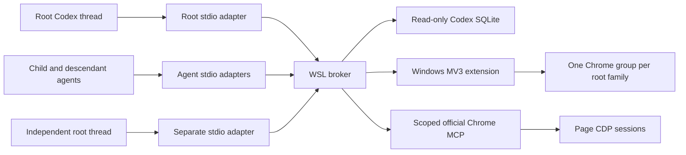

# Architecture and behavior

## Candidate status

Adapter and extension source version **0.4.0** implement the root-family and page-lease contract below. This candidate is **not deployed**. New-model Windows Chrome acceptance has not run: an isolated official-backend connection was rejected by canonical-root validation of Windows paths, and that protection was not bypassed. See [ACCEPTANCE.md](ACCEPTANCE.md) for the current evidence and blocker; earlier browser acceptance applies to its recorded installed versions.

## Components

The broker resolves family membership and arbitrates caller leases. The extension manages real Chrome groups, membership and tab lifecycle; a pinned, patched official Chrome DevTools MCP performs page operations. No separate automation engine or Windows Node daemon is required.

Stdio adapters connect over a local Unix socket. The extension connects to a loopback WebSocket listener; pairing checks both the extension origin and a locally generated random token. Pairing material and runtime ledgers are not source artifacts. This boundary does not defend against arbitrary programs running as the same OS user.

## Caller identity and root families

The authorization chain is:

`verified caller thread → root family → current Chrome membership + caller lease → exact target → official MCP pageId`.

`_meta.threadId` must be a UUID matching `_meta["x-codex-turn-metadata"].thread_id`. The model never supplies its identity as a tool argument. CLI version is diagnostic metadata. One active controller is allowed per caller thread; different child agents keep their own controllers and leases within the same family.

`CodexThreads` follows `thread_spawn_edges.child_thread_id → parent_thread_id` through every ancestor to the root. These historical edges establish family membership independently of their `status`. A fork without a spawn edge is an independent root. Source metadata identifies subagents but does not substitute for an official edge: missing thread rows or a subagent whose edge is not visible return `THREAD_FAMILY_NOT_READY`. Database/schema failures return explicit `THREAD_DATABASE_*` errors and never become an independent root.

Each broker lazily opens one read-only connection to `${CODEX_HOME:-~/.codex}/state_5.sqlite` and closes it at shutdown. Queries synchronously materialize their results; no transaction waits across browser or network work. Confirmed caller-to-root mappings are cached along the resolved path. Incomplete results and failures are retryable. Controller/process liveness is tracked separately from this immutable family cache.

A title, URL, connection ID or PID grants no ownership. Group labels use the **root** thread's current `[Project]Thread name`: explicit Codex project, then the longest registered project-root match, then repository or cwd name. Linked Git worktrees use the original repository name. User-renamed `threads.name` precedes `threads.title`; an unpersisted display record can use the client cwd and short root ID. Labels contain at most 80 Unicode code points, with up to 32 for the project; matching prefixes are not duplicated. The two-second display cache refreshes on later operations independently of the family cache.

## Current group membership and page references

One stable colored Chrome group belongs to each root family and is created lazily. Opening a managed page binds an existing ordinary Chrome window, creating an unfocused window only when none exists. Explicitly importing a tab into an empty family creates a group around that original tab. Selecting a window does not grant access to its other tabs.

The extension enumerates the family's **current real group members** in Chrome tab order. A tab manually moved into the group becomes an external, protected member. Moving a tab out or closing it immediately removes its usable membership; returning later creates fresh membership. The adapter accepts these user changes and never reconstructs historical order or reopens missing pages.

`list_pages` shows available pages and pages leased to this caller. It neither claims nor renews a lease. `position` is the one-based position in the full current group before filtering, so visible positions can have gaps. Resolve a newly requested position once from a fresh list, then use the returned stable `pageId` for that task. Do not repeatedly reinterpret the original position after tab reordering.

Public page handles include extension generation, exact CDP target, membership ID and lease version: `p:<generation>:<targetId>:<membershipId>:<leaseVersion>`. Numeric upstream IDs are translated per call. Element, console and network references additionally include the upstream epoch. Membership or lease changes invalidate old handles and their derived references; obtain a fresh list and page state before continuing.

## Page leases

The broker persists leases per exact target. A page operation acquires or renews a caller's five-minute idle lease; `release_page` makes it available when work finishes. Sibling agents cannot see or take a page held by another caller. Listing alone never reserves a page. A fresh grant after release or idle expiry advances the lease version, including for the previous caller, so stale observations cannot authorize new work.

Executing operations and operations with an unknown outcome remain held rather than expiring into another caller's control. Restarting the broker treats a persisted executing operation as unknown. Return the explicit failure and reconcile its actual result before releasing or retrying; browser mutations are never automatically replayed.

`open_page(url, slot="main")` reuses only an explicitly managed, reusable slot. A matching URL does not reload; another URL navigates that managed page. A busy slot returns an error rather than stealing the sibling's page. Imported/manual pages never become an implicit `main` slot, and releasing a lease does not make them reusable. The default limit is eight pages per family, configurable up to 100.

## Discovering and importing a user tab

`get_active_tab` reads metadata for the unique active tab in the most recently used normal Chrome window, even while Chrome lacks OS focus. Discovery grants no page-content access. Match that metadata to the user's task, then explicitly call `move_tab_to_workspace` with the exact candidate `pageId`.

The move uses the original tab, preserving its current page state without cloning or navigation. It need not still be active. A nonempty family receives it in its existing group; an empty family creates a group from the tab. It becomes the active tab without bringing the OS window to the foreground. Another family's member or another caller's leased page cannot be taken.

External/manual transfers expose `canClose=false`, are not reusable slots, and remain protected by exact target for the extension session, including after later transfers. Page interaction still requires the caller's lease. Explicit close and automatic cleanup both respect this protection. Do not use JavaScript `window.close`, group/window operations or another tool path to bypass it. Managed pages can be explicitly closed, including the family's last managed page. Retention protects a page from automatic cleanup; it does not disable an otherwise permitted explicit close.

Popups inherit the family only when their actual CDP opener maps to a current member. Matching URLs, titles, colors and historical tab IDs never establish ownership. Startup blank tabs are not removed automatically.

## Screenshots and shared resources

Only screenshots hold the shared window capture queue. The extension verifies membership, records the previous active tab's exact target, activates the leased capture tab, and restores selection in `finally`. A manual switch during capture is respected. Restoring selection grants no content access to another tab.

No `Page.bringToFront` or OS-window restoration is used. In a minimized window, the official screenshot handler temporarily starts a 1×1 screencast in its page CDP session to keep frames available. Actual output comes from official page/element screenshot methods. Async cleanup is awaited; cancellation stops that frame producer once. Other windows do not start this screencast. Historical acceptance for this path is versioned separately from the unaccepted 0.4.0 candidate.

Page operations use per-page serialization after upstream context refresh; unrelated pages can progress concurrently. The extension's capture recovery timer is separate from a caller's page lease. See [UPSTREAM.md](UPSTREAM.md) for patch boundaries.

## Failures, cancellation and recovery

Requests have a total deadline, bridge calls a bounded wait, and upstream calls a maximum 25-second wait. Cancellation propagates through queued work and bridge/upstream boundaries. Commands already dispatched may still take effect; `UNKNOWN` is not rollback. Queue failures do not permanently poison subsequent requests.

An unresponsive Chrome close can return `PAGE_CLOSE_PENDING` without falsely revoking a still-existing page. Late Chrome events or a later query confirm removal; do not replay the close request while its result is unknown.

A broker reconnect preserves receipts when the extension generation is unchanged. A new browser/extension session requires explicit `reset_workspace`; it does not adopt old numeric IDs, targets or same-named groups. An explicit upgrade preserves a generation only after checking exact tab/target/group/window receipts and the candidate's compatibility requirements.

## Family cleanup and shared browser state

Process-exit cleanup is family-wide. Stdio adapters register their PID; the broker records Linux process start time and associates that lifetime with a verified caller. One child's exit cannot close pages while any known family controller remains attached or its registered process remains alive. Root-cache membership does not imply controller activity. If a child was the first browser caller and the root has never registered a controller, its exit cannot prove the family has ended; automatic cleanup conservatively preserves that group.

After every known caller is detached and its exact process has exited, cleanup waits `closedThreadGraceMs` (30000 by default). Its periodic check uses process lifetime, not time since the last browser call. A host that keeps stdio alive does not produce an exit signal. Retained, externally protected and actively leased/unknown pages remain untouched. Empty families do not trigger historical page revival. Completed cleanup stops querying a group containing only retained/protected pages until a family caller reconnects.

Set `closedThreadGraceMs` to `null` to disable process-exit cleanup. Historical workspaces without registration remain untouched unless the optional `detachedTtlMs` policy is explicitly enabled; that policy never expires a known live caller. A broker restart alone does not prove exit. PID/start-time evidence is never a substitute for thread identity, current membership or a lease.

`list_pages` reports cleanup enablement, process registration, grace period and reconnect advice. Cookies, site storage and website accounts remain shared. This project constrains its exposed tools; it does not isolate shared account effects or independent shell/CDP programs.

## Toolbar and status popup

The toolbar icon shows the number of MCP clients that completed the broker hello handshake, with identified active callers reported separately. The authenticated bridge pushes small count/lease summaries after connection or call changes and on its existing heartbeat; it does not renew page leases. A popup runtime port marks when the status surface is actually open. Only an open popup or an explicit status request queries current group metadata. Unknown/disconnected data stays labelled, and diagnostic copy excludes page data, titles and credentials. See [EXTENSION_UI.md](EXTENSION_UI.md) and the source [visual system](../DESIGN.md).
