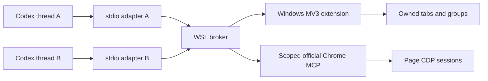

# Architecture and behavior

## Components

The broker coordinates ownership and the extension manages tab/group lifecycle. Page operations use a pinned, patched copy of the official Chrome DevTools MCP. No separate automation engine or Windows Node daemon is required.

The stdio adapters connect to a local Unix socket. The extension connects to a loopback WebSocket listener; pairing checks both the extension origin and a locally generated random token. Pairing material and runtime ledgers are not source artifacts. This boundary does not defend against arbitrary programs running as the same OS user.

## Identity and references

The authorization chain is:

`Codex thread ID → workspace → extension generation + tabId/targetId → upstream pageId`.

`_meta.threadId` must be a UUID matching `_meta["x-codex-turn-metadata"].thread_id`. The model does not supply identity as a tool argument. CLI version is diagnostic, not a version allowlist. A second active controller for the same thread is rejected.

Titles are display metadata read from the local Codex thread database when available. A title, URL, connection ID or PID never grants ownership. This integration depends on the current Codex metadata and local title-database shape; other MCP clients need a separately designed identity contract.

Group names use `[Project]Thread name`. The project comes from the thread's explicit Codex project, then its longest registered project-root match, then the repository root or working-directory name. Linked Git worktrees use the original repository name. A user-renamed thread takes precedence over the generated title. Unpersisted threads use the stdio client's working directory and a short thread ID. Labels contain at most 80 Unicode code points, with up to 32 for the project; existing matching prefixes are not duplicated. The two-second metadata cache refreshes labels on subsequent owned operations. New page creation supplies the label with its existing open request; slot reuse refreshes the group label without an extra preliminary title request.

Public page handles are `p:<extension-generation>:<targetId>`. Internal numeric MCP page IDs are translated per call. Element, network and console references are also page- and upstream-epoch-bound.

## Window and tab ownership

The first browser operation binds an existing ordinary Chrome window; subsequent threads reuse it. An unfocused window is created only when none exists. Each thread gets one stable colored group, created lazily with its first page. Existing user tabs are not adopted.

`open_page(url, slot="main")` reuses the named slot. A matching URL does not force reload. A different URL navigates that slot; use another slot to preserve an editing page. Default limit is eight tabs per workspace, configurable up to 100. Retained pages are exempt from automatic cleanup, not from explicit close.

Popups inherit ownership only after their actual CDP opener maps to a registered parent. Moving a tab out revokes access; moving a foreign tab into a group does not transfer ownership. A surviving empty group can be reused without adopting its ordinary user tabs.

After a successful open, the adapter may remove disposable ungrouped startup blank tabs in the bound window. Registered, pinned, grouped, opener-owned, loading and navigating tabs are protected. There is no periodic blank-tab scan.

## Screenshots and shared resources

Only screenshots hold the shared window capture queue. The extension verifies ownership and records the previous active tab's exact target, activates the owned capture tab, and restores selection in finally. A manual switch during capture is respected. Restoring selection never grants content access to an ordinary user tab.

No `Page.bringToFront` or OS-window restoration is used. In a minimized window, the official screenshot handler temporarily starts a 1×1 screencast in its page CDP session to keep frames available. Actual output still comes from official page/element screenshot methods. Async cleanup is awaited; cancellation stops the same frame producer once. Other windows do not start this screencast.

Page operations use per-page serialization after the upstream context refresh; unrelated pages can progress concurrently. The extension capture lease has a bounded recovery timer. See [UPSTREAM.md](UPSTREAM.md) for the patch boundaries.

## Failures, cancellation and recovery

Requests have a total deadline, bridge calls a bounded wait, and upstream calls a maximum 25-second wait. Cancellation propagates through queued work and bridge/upstream boundaries. Browser commands already dispatched may still take effect; `UNKNOWN` is not rollback. Calls are never automatically replayed.

An unresponsive Chrome close can return `PAGE_CLOSE_PENDING` without falsely revoking a still-existing page. Late Chrome events or a successful later query confirm removal. Queue failures do not permanently poison subsequent requests.

A broker reconnect preserves existing workspaces when the extension generation is unchanged. A new browser/extension session requires explicit reset and does not adopt old numeric IDs or same-named groups. The explicit upgrade procedure preserves a generation only after verifying exact tab/target/group/window receipts.

Closed-thread cleanup is enabled by default. A stdio adapter registers its PID during the broker handshake; the broker records the Linux process start time and associates that lifetime with threads only after validating their tool-call metadata. A disconnected controller is collected only after that exact process has exited and the `closedThreadGraceMs` grace period (30 seconds by default) has elapsed. A five-second broker check detects exit; it does not use time since the last browser call. Live disconnected processes, thread switches on a shared connection, and broker restarts preserve pages. Reattaching a thread cancels pending cleanup. This depends on the host ending a thread's stdio adapter when the thread unloads; a host that keeps it alive does not produce a close signal.

Cleanup reuses the extension's ownership checks, skips retained pages, and removes an empty broker workspace record after confirming page removal. Foreign tabs manually placed in a group remain untouched, so their group remains visible. Retained workspaces are not repeatedly scanned once cleanup has finished. A close with an uncertain result is queried for eventual completion without replaying the close request; its failure does not prevent another thread's cleanup. Resuming the affected thread lets it resolve any unsaved-change dialog normally.

Set `closedThreadGraceMs` to `null` to disable process-exit cleanup. Existing configurations without this field use 30000. Already-running older stdio clients and historical workspaces without a registered process are left untouched; reconnect the MCP client to enroll subsequent calls. The optional `detachedTtlMs` policy remains disabled by default. If explicitly enabled, it also covers detached workspaces without process evidence, but never expires a known live controller. PID and start time are lifetime evidence, not substitutes for thread or page authorization.

`list_pages` reports `runtime.cleanup.enabled`, `controllerRegistered` and `graceMs`. `reconnectRecommended` identifies a missing process registration when exit cleanup is enabled; a cosmetic server version bump alone does not request reconnecting an otherwise registered client.

Cookies, site storage and website accounts remain shared. This project controls the tools it exposes, not independent shell/CDP programs or cross-page effects inside a shared website account.
